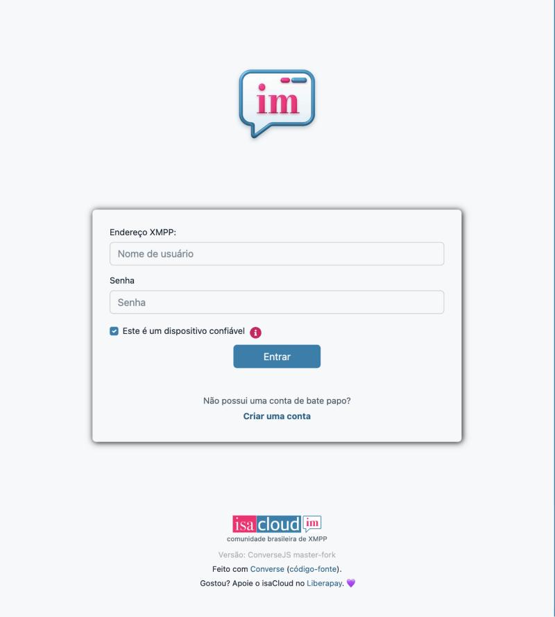
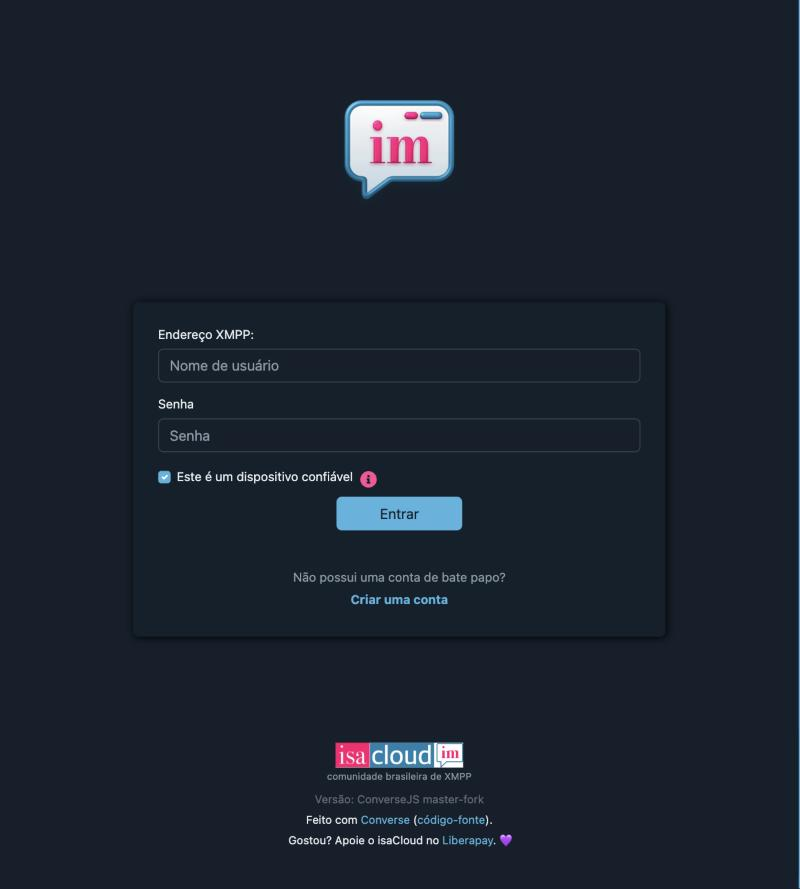

<h1 align="center">isaCloud Web</h1>

<p align="center">
  <a href="README.md"><strong>English</strong></a> ·
  <a href="README.pt-BR.md">Português (Brasil)</a>
</p>

<p align="center">
  
</p>

<p align="center"><strong>Instant messaging with the isaCloud touch.</strong><br>
A free, beautiful XMPP client for the browser, built on top of Converse.</p>

<p align="center">
  <a href="https://chat.isacloud.cc"><b>Open the chat</b></a> ·
  <a href="https://isacloud.com.br">isacloud.com.br</a> ·
  <a href="https://github.com/isaitgirl/isaCloud-Web">Source on GitHub</a> ·
  <a href="https://isacloud.com.br/#doacoes">Support isaCloud</a>
</p>

<p align="center">
  
  
</p>

## About

**isaCloud Web** is a fork of [Converse](https://conversejs.org), the open-source XMPP chat client
for the browser by JC Brand and contributors. It uses the open **XMPP** protocol, so you can talk
to anyone on any federated server — including your own. It runs at
**[chat.isacloud.cc](https://chat.isacloud.cc)** for the isaCloud community and is the web sibling
of [isaCloud for iOS](https://github.com/isaitgirl/isaCloud-iOS) (built on Monal) and
[isaCloud Messenger](https://codeberg.org/isafashiondev/isaCloudMessenger) for Android (built on
Conversations).

The app is distributed under the **Mozilla Public License 2.0** of Converse (see
[LICENSE](LICENSE)). The source of this fork lives on
[GitHub](https://github.com/isaitgirl/isaCloud-Web), and the chat footer links back to it.

## Upstream synchronization

isaCloud Web tracks Converse and stays in sync with upstream. The working branch is `isacloud`;
`master` mirrors Converse and is only a landing point for upstream commits. For now the fork
follows the Converse `master` branch (the future 15.0) on purpose, because it carries the
XEP-0198 reconnection fix; once 15.0 is released, the fork goes back to following releases.

Changes in this fork are **branding, configuration and usability** improvements, kept in a few
files (theme, page and configuration) so that upstream merges stay cheap. Upstream updates
continue to be merged.

## Features

Everything Converse offers, plus what isaCloud adds or turns on:

- Ready for **isacloud.im**: sign in right from the login screen.
- 1:1 chats, private groups and public channels, with the room list of the server.
- End-to-end encryption with **OMEMO** (legacy and OMEMO 2), **on by default**.
- **Joins channels with your nickname** (from your profile, or the name in your address). You can
  change it later.
- Message archive (MAM) always on, so your history follows you across devices.
- **Light and dark isaCloud themes** (pink `#ff006f`, blue `#1780ad`), following the system
  setting, and the **system font** on every platform, like isacloud.com.br.
- A focused, chat-only full-screen layout that works on phones too.
- Installable as an app (web manifest), and opens `xmpp:` links.

Fixes carried by the fork:

- OMEMO prekey ids are stored and used as numbers.
- Body-less OMEMO stanzas (chat states, read markers, heartbeats) no longer carry an XEP-0380
  hint, so Gajim stops showing "encrypted with OMEMO:2 and could not be decrypted"
  ([conversejs/converse.js#4100](https://github.com/conversejs/converse.js/issues/4100)).

## Using it

Open **[chat.isacloud.cc](https://chat.isacloud.cc)** in any modern browser. On a phone, use
"Add to Home Screen" to keep it as an app.

## Build

Requirements: **Node.js** and **npm**.

```bash
git clone --filter=blob:none https://github.com/isaitgirl/isaCloud-Web.git
cd isaCloud-Web
npm install
./isacloud/build.sh          # builds isacloud/out/ and isacloud/isacloud-web.tar.gz
npx http-server isacloud/out -c-1 -p 8097
```

Then open http://localhost:8097. The isaCloud files are:

- `isacloud/index.html` — the page and the Converse configuration (as JSON);
- `isacloud/init.js`, `isacloud/manifest.json` — bootstrap and web app manifest;
- `src/shared/styles/themes/isacloud.scss` — the `isacloud` and `isacloud-dark` themes;
- `images/isacloud/` — icons and logo.

For development, tests and everything else, the Converse documentation applies:
[conversejs.org/docs](https://conversejs.org/docs/). For the fork's changes there is a reduced
test suite, about a minute long: `./isacloud/test.sh` (it builds with `npm run dev` first, since
Vitest runs against the built bundle).

## Security and privacy

- **OMEMO** for encrypted conversations, on by default.
- Your data (history, OMEMO keys) is kept in the browser's IndexedDB, and the page asks the
  browser to keep it persistent. Uncheck "This is a trusted device" at login on a shared computer:
  then nothing is kept after you leave.
- No ad tracking and no analytics service.
- Connects to isacloud.im over secure WebSocket (TLS).

## Credits

- **Converse** — JC Brand and contributors. This fork would not exist without their work. The
  [Converse documentation](https://conversejs.org/docs/) still applies to the app's core, and the
  original README is on [GitHub](https://github.com/conversejs/converse.js#readme).
  Consider [supporting Converse](https://liberapay.com/jcbrand) too.
- **isaCloud Web** — maintained by Isadora / [isacloud.com.br](https://isacloud.com.br).
- License: **Mozilla Public License 2.0** — see [LICENSE](LICENSE).

## Contributing

Found a bug or have an idea? Open an issue on
[GitHub](https://github.com/isaitgirl/isaCloud-Web/issues). Every change starts on a new branch
from `isacloud` and comes back through a pull request to `isacloud`. This fork does not send
pull requests to the Converse upstream; changes stay here.
