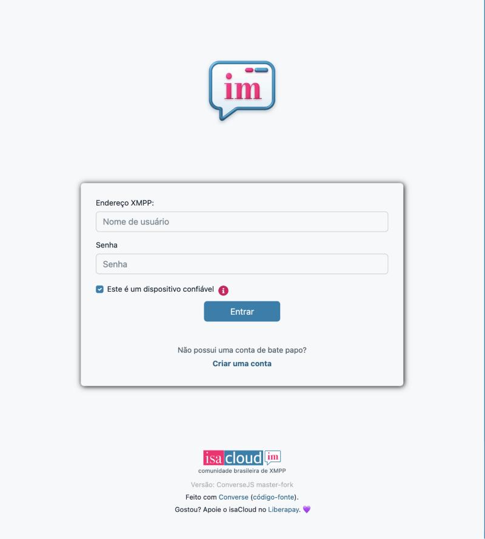
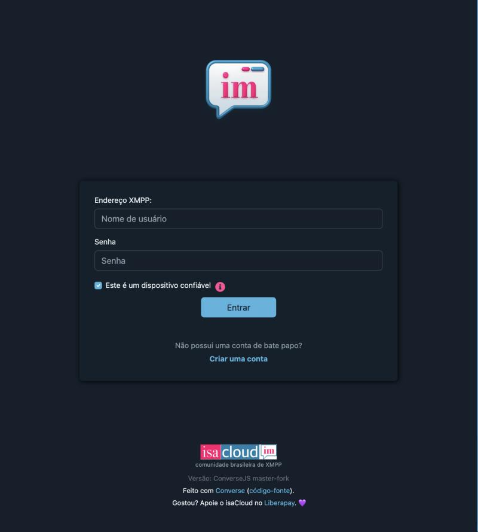

<h1 align="center">isaCloud Web</h1>

<p align="center">
  <a href="README.md">English</a> ·
  <a href="README.pt-BR.md"><strong>Português (Brasil)</strong></a>
</p>

<p align="center">
  
</p>

<p align="center"><strong>Mensagens instantâneas com o toque do isaCloud.</strong><br>
Um cliente XMPP livre e bonito para o navegador, feito sobre o Converse.</p>

<p align="center">
  <a href="https://chat.isacloud.cc"><b>Abrir o chat</b></a> ·
  <a href="https://isacloud.com.br">isacloud.com.br</a> ·
  <a href="https://github.com/isaitgirl/isaCloud-Web">Código no GitHub</a> ·
  <a href="https://isacloud.com.br/#doacoes">Apoie o isaCloud</a>
</p>

<p align="center">
  
  
</p>

## Sobre

O **isaCloud Web** é um fork do [Converse](https://conversejs.org), o cliente de chat XMPP de
código aberto para o navegador, de JC Brand e colaboradores. Ele usa o protocolo aberto **XMPP**,
então você conversa com qualquer pessoa em qualquer servidor federado, inclusive o seu. Ele roda em
**[chat.isacloud.cc](https://chat.isacloud.cc)** para a comunidade do isaCloud e é o irmão web do
[isaCloud para iOS](https://github.com/isaitgirl/isaCloud-iOS) (feito sobre o Monal) e do
[isaCloud Messenger](https://codeberg.org/isafashiondev/isaCloudMessenger) para Android (feito
sobre o Conversations).

O app é distribuído sob a **Mozilla Public License 2.0** do Converse (veja [LICENSE](LICENSE)). O
código deste fork fica no [GitHub](https://github.com/isaitgirl/isaCloud-Web), e o rodapé do chat
aponta para ele.

## Sincronização com o upstream

O isaCloud Web acompanha o Converse e se mantém em dia com o upstream. A branch de trabalho é a
`isacloud`; a `master` espelha o Converse e serve só de ponto de chegada dos commits do upstream.
Por enquanto o fork segue de propósito a branch `master` do Converse (a futura 15.0), porque ela
traz a correção da reconexão XEP-0198; quando a 15.0 sair, o fork volta a seguir as versões
lançadas.

As mudanças deste fork são de **marca, configuração e usabilidade**, concentradas em poucos
arquivos (tema, página e configuração) para que trazer as novidades do upstream continue barato.
As atualizações do upstream continuam sendo mescladas.

## Recursos

Tudo o que o Converse oferece, mais o que o isaCloud acrescenta ou liga:

- Pronto para o **isacloud.im**: entre direto na tela de login.
- Conversas individuais, grupos privados e canais públicos, com a lista de salas do servidor.
- Criptografia de ponta a ponta com **OMEMO** (o legado e o OMEMO 2), **ligada por padrão**.
- **Entra nos canais com o seu apelido** (o do perfil ou o nome do seu endereço). Dá para trocar
  depois.
- Arquivo de mensagens (MAM) sempre ligado, para o histórico acompanhar você entre dispositivos.
- **Temas claro e escuro do isaCloud** (rosa `#ff006f`, azul `#1780ad`), seguindo o sistema, e a
  **fonte do sistema** em qualquer plataforma, como no isacloud.com.br.
- Tela cheia só com o chat, sem distrações, que funciona também no celular.
- Pode ser instalado como app (manifest web) e abre links `xmpp:`.

Correções que o fork traz:

- Os ids de prekey do OMEMO são gravados e usados como número.
- Stanzas OMEMO sem corpo (estado do chat, marcas de leitura, heartbeats) não levam mais a marca
  da XEP-0380, e o Gajim para de mostrar "encrypted with OMEMO:2 and could not be decrypted"
  ([conversejs/converse.js#4100](https://github.com/conversejs/converse.js/issues/4100)).

## Como usar

Abra **[chat.isacloud.cc](https://chat.isacloud.cc)** em qualquer navegador moderno. No celular,
use "Adicionar à tela de início" para ter o chat como app.

## Build

Requisitos: **Node.js** e **npm**.

```bash
git clone --filter=blob:none https://github.com/isaitgirl/isaCloud-Web.git
cd isaCloud-Web
npm install
./isacloud/build.sh          # gera isacloud/out/ e isacloud/isacloud-web.tar.gz
npx http-server isacloud/out -c-1 -p 8097
```

Depois abra http://localhost:8097. Os arquivos do isaCloud são:

- `isacloud/index.html`: a página e a configuração do Converse (em JSON);
- `isacloud/init.js`, `isacloud/manifest.json`: inicialização e manifest do app web;
- `src/shared/styles/themes/isacloud.scss`: os temas `isacloud` e `isacloud-dark`;
- `images/isacloud/`: ícones e logotipo.

Para desenvolvimento, testes e todo o resto vale a documentação do Converse:
[conversejs.org/docs](https://conversejs.org/docs/). Para as mudanças do fork há uma suíte de
testes reduzida, de cerca de um minuto: `./isacloud/test.sh` (ela gera o build com `npm run dev`
antes, porque o Vitest roda sobre o bundle gerado).

## Segurança e privacidade

- **OMEMO** nas conversas cifradas, ligado por padrão.
- Seus dados (histórico, chaves OMEMO) ficam no IndexedDB do navegador, e a página pede ao
  navegador que os mantenha de forma persistente. Em computador compartilhado, desmarque "Este é
  um dispositivo confiável" no login: aí nada fica guardado quando você sair.
- Sem rastreamento de anúncios e sem serviço de analytics.
- Conecta ao isacloud.im por WebSocket seguro (TLS).

## Créditos

- **Converse**: JC Brand e colaboradores. Este fork não existiria sem o trabalho deles. A
  [documentação do Converse](https://conversejs.org/docs/) continua valendo para o núcleo do app,
  e o README original está no [GitHub](https://github.com/conversejs/converse.js#readme).
  Considere [apoiar o Converse](https://liberapay.com/jcbrand) também.
- **isaCloud Web**: mantido pela Isadora / [isacloud.com.br](https://isacloud.com.br).
- Licença: **Mozilla Public License 2.0**, veja [LICENSE](LICENSE).

## Como contribuir

Achou um bug ou teve uma ideia? Abra uma issue no
[GitHub](https://github.com/isaitgirl/isaCloud-Web/issues). Toda mudança começa numa branch nova a
partir da `isacloud` e volta por um pull request para a `isacloud`. Este fork não envia pull
requests para o Converse; as mudanças ficam aqui.
